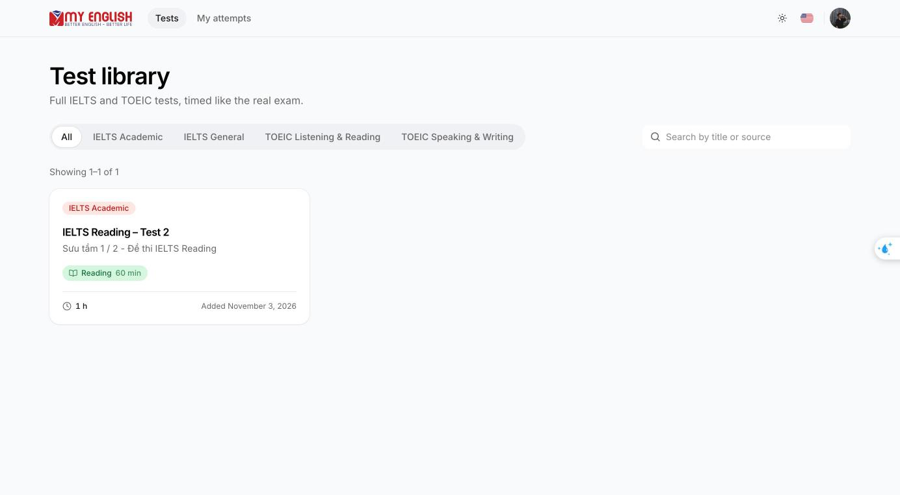
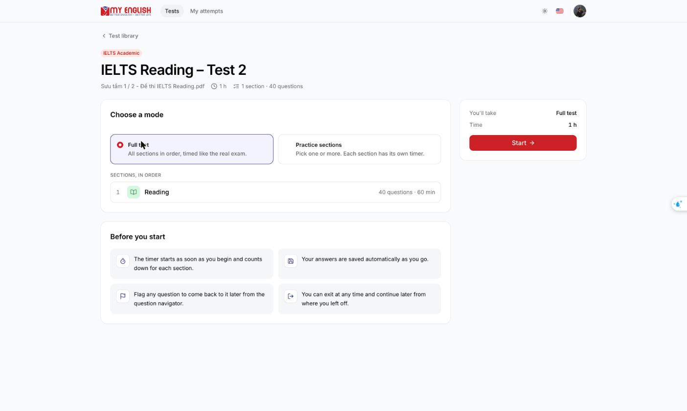
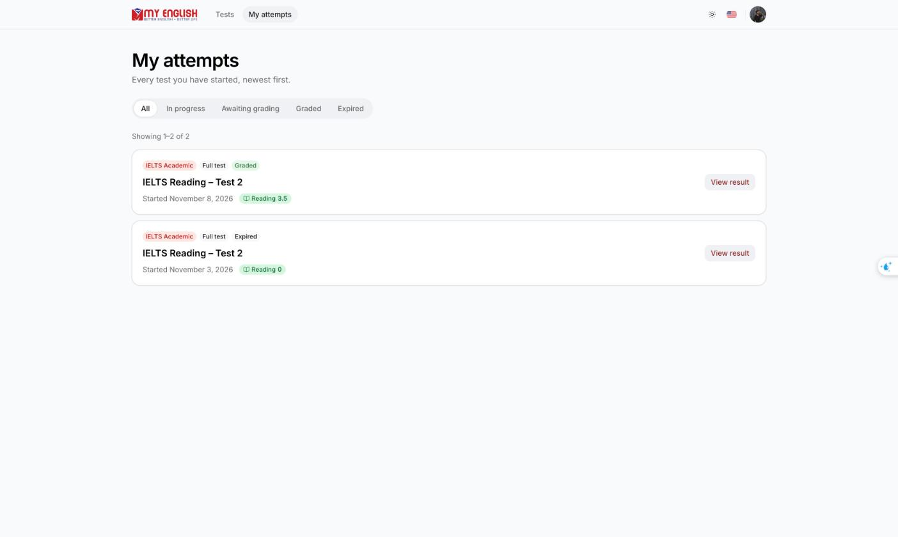
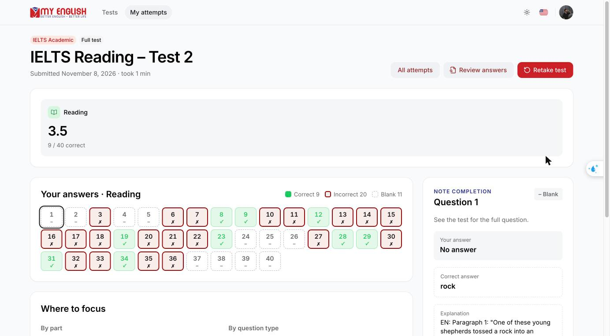
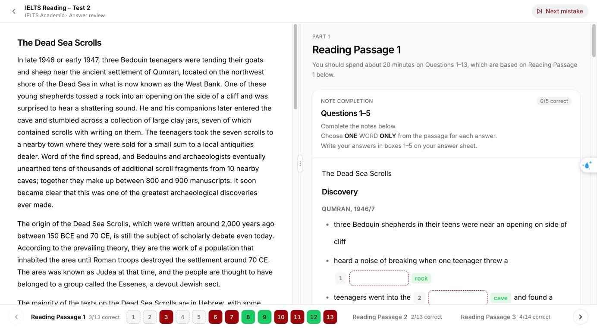
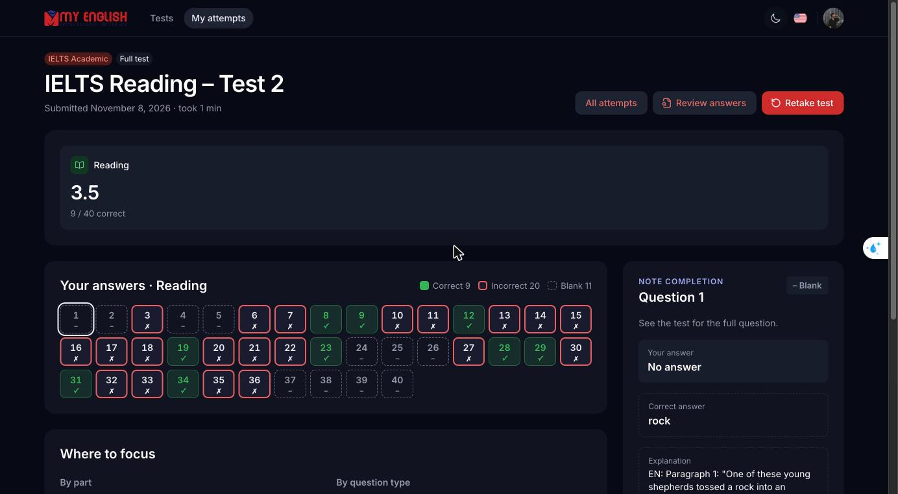
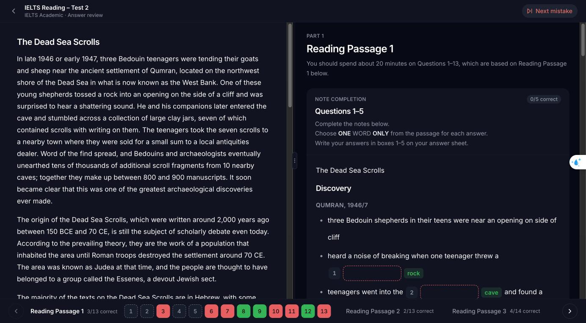

# english-student

The MyEnglish student app is where students browse IELTS and TOEIC tests, take timed exams, and review their results with answer explanations. It is a Next.js app that also acts as the backend-for-frontend (BFF) between the browser and the API.

## The MyEnglish system

| Repo                                                  | Role                                                                     | Stack                          |
| ----------------------------------------------------- | ------------------------------------------------------------------------ | ------------------------------ |
| [english-service](../english-service/README.md)       | REST API, database, scoring, file storage                                | NestJS 12, TypeORM, PostgreSQL |
| [english-backoffice](../english-backoffice/README.md) | Staff CMS: content, users and roles, grading, student results            | React Router 7 SPA, Vite       |
| **english-student** (this repo)                       | Student app: test library, exams, results. Also acts as the BFF for auth | Next.js 16                     |

## Screenshots

| Test library                                       | Test detail                                      |
| -------------------------------------------------- | ------------------------------------------------ |
|  |  |

| My attempts                                      | Result                                 |
| ------------------------------------------------ | -------------------------------------- |
|  |  |

**Answer review.** The passage and questions appear side by side, the same layout as the exam, with each answer marked right or wrong.



**Dark mode.**

| Result                                            | Answer review                                                   |
| ------------------------------------------------- | --------------------------------------------------------------- |
|  |  |

## Features

- **Test library**: published IELTS Academic/General and TOEIC tests, filterable by exam type and searchable.
- **Exams**: take a full test (all sections in order) or practise selected sections. Each section has its own timer, and answers autosave so a student can leave and resume. Questions can be flagged for later.
- **Skills**: Listening (audio), Reading (split passage view), Writing (essay editor) and Speaking (in-browser recording, uploaded directly to storage).
- **Results**: band or scaled scores, a per-question answer grid, breakdowns by part and by question type, and bilingual EN/VI explanations with passage evidence. IELTS Writing and Speaking show teacher assessments once graded.
- **History**: every attempt, filterable by status (in progress, awaiting grading, graded, expired).
- English and Vietnamese UI (next-intl), plus light and dark themes.

## How auth works (BFF)

Students sign in with Google. The API redirects back with a short-lived code that the Next.js server exchanges for tokens (`src/app/api/session`). Tokens are kept in `httpOnly` cookies that the browser's JavaScript cannot read. `src/proxy.ts` forwards `/api/bff/*` calls to the API with the access token attached, refreshes the session when needed, and passes on the client IP for rate limiting. For the full flow, see [english-service/docs/auth-flow.md](../english-service/docs/auth-flow.md).

## Tech stack

Next.js 16 (App Router) · React 19 · HeroUI v3 + Tailwind CSS v4 · TanStack Query · next-intl · next-themes · react-hook-form + yup · CASL · Vitest + Testing Library · Playwright

## Getting started

```bash
pnpm install
cp .env.example .env.local    # point NEXT_PUBLIC_API_URL at your english-service
pnpm dev                      # http://localhost:3000
```

Google login needs the app on a domain the API redirects to. For local HTTPS on `https://student.myenglish.com`, generate `student.myenglish.com.pem` and `student.myenglish.com-key.pem` with mkcert at the repo root, map the host to `127.0.0.1`, and run `pnpm dev-ssl`. This starts Next on port 3400 behind `local-ssl-proxy` on 443.

### Environment variables

| Variable                    | Purpose                                                              |
| --------------------------- | -------------------------------------------------------------------- |
| `NEXT_PUBLIC_API_URL`       | API origin                                                           |
| `ACCESS_TOKEN_COOKIE_NAME`  | Access token cookie name (default `st_access_token`)                 |
| `REFRESH_TOKEN_COOKIE_NAME` | Refresh token cookie name (default `st_refresh_token`)               |
| `CLIENT_IP_HEADER`          | Header holding the real client IP when behind a proxy (optional)     |
| `TRUSTED_PROXY_HOPS`        | Number of trusted proxies in `X-Forwarded-For` (optional, default 0) |

## Scripts

| Command                                        | Description                                       |
| ---------------------------------------------- | ------------------------------------------------- |
| `pnpm dev` / `pnpm dev-ssl`                    | Dev server / dev server behind local HTTPS        |
| `pnpm build` / `pnpm start` / `pnpm start-ssl` | Production build and serve                        |
| `pnpm typecheck`                               | `next typegen` + `tsc --noEmit`                   |
| `pnpm lint` / `pnpm lint:fix`                  | oxlint                                            |
| `pnpm format` / `pnpm format:check`            | oxfmt                                             |
| `pnpm test`                                    | Unit tests (Vitest)                               |
| `pnpm test:e2e` / `pnpm test:e2e:ui`           | Playwright against the mock API in `e2e/mock-api` |

## Project structure

```
src/
  app/
    (auth)/login             sign-in
    (main)/                  test library, test detail, attempt history, results
    (exam)/                  exam player (tests/[slug]/take) and answer review
    api/session              BFF session endpoints (Google code exchange, expiry)
  proxy.ts                   BFF proxy: forwards /api/bff/*, refreshes tokens
  components/                exam, results, review, tests, attempts, layouts, shared
  lib/                       api client, auth/session, exam and results logic
  i18n/  providers/  configs/  constants/  types/
messages/                    en.json, vi.json
e2e/                         Playwright specs + mock API server
```

## CI

On pull requests, CI runs `format:check` → `lint` → `typecheck` → `test` → `build`, then the Playwright suite against the production build and the mock API.

## Conventions

- Linting and formatting use oxlint and oxfmt. Husky runs lint-staged on commit.
- Commits follow [Conventional Commits](https://www.conventionalcommits.org/) (commitlint).
- This Next.js version changes some APIs; see [AGENTS.md](AGENTS.md) and `node_modules/next/dist/docs/` before relying on older patterns.
- The result view logic in `lib/results/view.ts` is mirrored in the backoffice (`src/utils/attemptResult.ts`); keep the two in sync.

## Further reading

- [AGENTS.md](AGENTS.md) / [CLAUDE.md](CLAUDE.md): notes for coding agents
- [docs/design/](docs/design/): HTML design mockups for each screen
